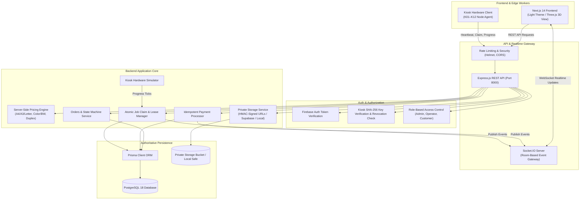

# Project Nightfall — System Architecture & Data Flow

## 🌟 Architecture Overview

Project Nightfall is a smart printing operations and kiosk fleet orchestration platform designed to handle high-concurrency order submission, authoritative server-side pricing, idempotent payment verification, and hardware-secured print job claiming across automated kiosk networks.



---

## 🔒 Security & Concurrency Design

### 1. Atomic Job Claiming (No Double-Prints)
When multiple kiosk workers attempt to claim the next job simultaneously:
- Queries target queued jobs using `tx.printJob.findFirst`.
- Executes an **optimistic conditional row update**:
  ```sql
  UPDATE "PrintJob"
  SET status = 'CLAIMED',
      "claimLeaseExpiresAt" = NOW() + INTERVAL '5 minutes',
      version = version + 1
  WHERE id = :jobId
    AND version = :expectedVersion
    AND (status = 'QUEUED' OR (status = 'CLAIMED' AND "claimLeaseExpiresAt" < NOW()))
  ```
- If another concurrent worker claimed it milliseconds earlier, `updatedCount.count` is 0, and the second worker receives `null` (HTTP 204 No Content). Exactly one worker wins the lease.

### 2. Idempotent Simulated Payments
- Every payment request mandates an `idempotencyKey`.
- Before charging or releasing a job, the database is queried for `payment.findUnique({ where: { idempotencyKey } })`.
- If found, the existing payment and order are returned without re-charging and without creating duplicate print jobs.
- All payment mutations and order transitions occur inside an atomic database transaction.

### 3. Server-Controlled Pricing
- The client cannot alter the price by modifying HTTP payloads.
- Any client-submitted total is discarded; the backend recalculates `subtotal`, `tax` (8%), and `totalAmount` based strictly on verified page count, copies, color mode, and paper size.

### 4. Revocable Kiosk Worker Credentials
- Kiosks authenticate via headers `x-kiosk-id` and `x-kiosk-key`.
- Kiosk keys are stored as cryptographically hashed values (`sha256(key)`) and verified using `crypto.timingSafeEqual`.
- Administrators can revoke compromised kiosks in real time (`POST /api/v1/kiosks/:id/revoke`), immediately rejecting all further worker operations with HTTP 403 Forbidden.

### 5. Physical Outcome Uncertainty Handling
- When hardware or network status is ambiguous (e.g. paper jam, fuser fault), the state machine transitions the print job to `UNCERTAIN` instead of blindly re-printing, preventing accidental duplication of sensitive documents.
- A physical incident is dispatched for human operator resolution.

